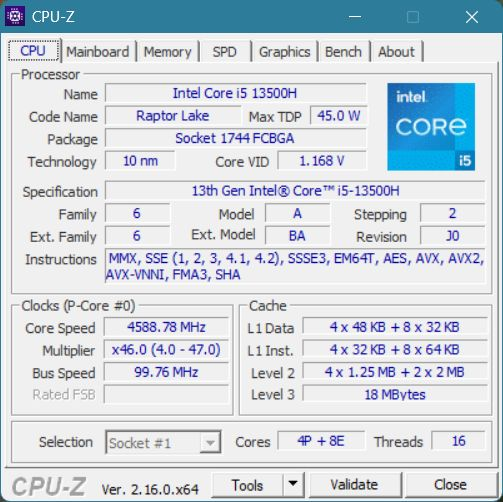
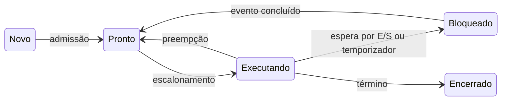
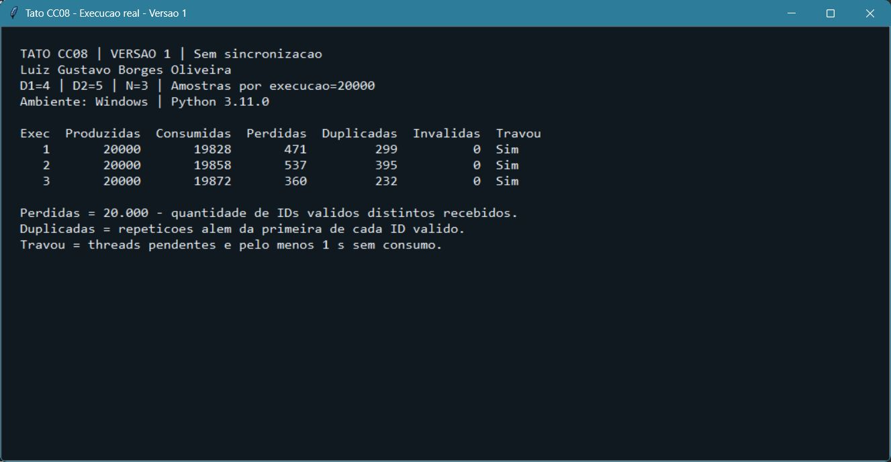
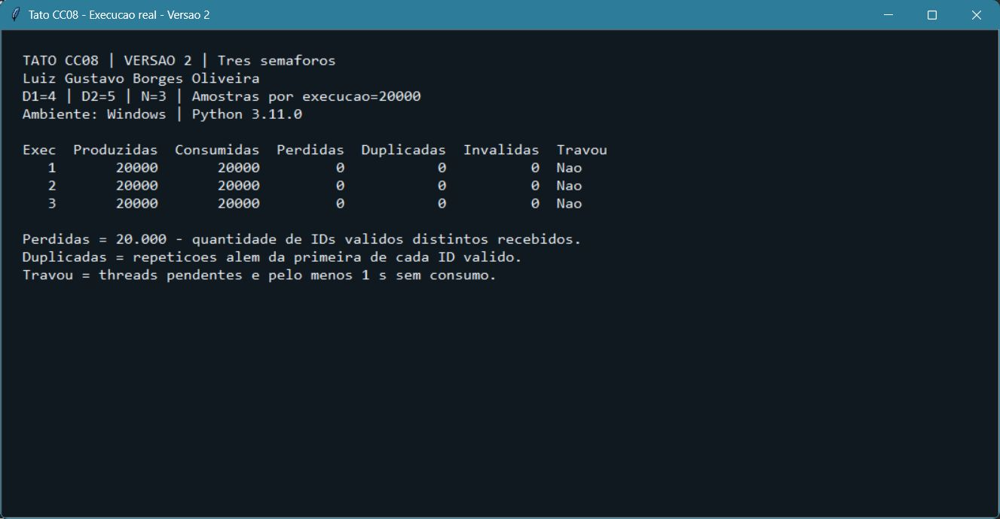
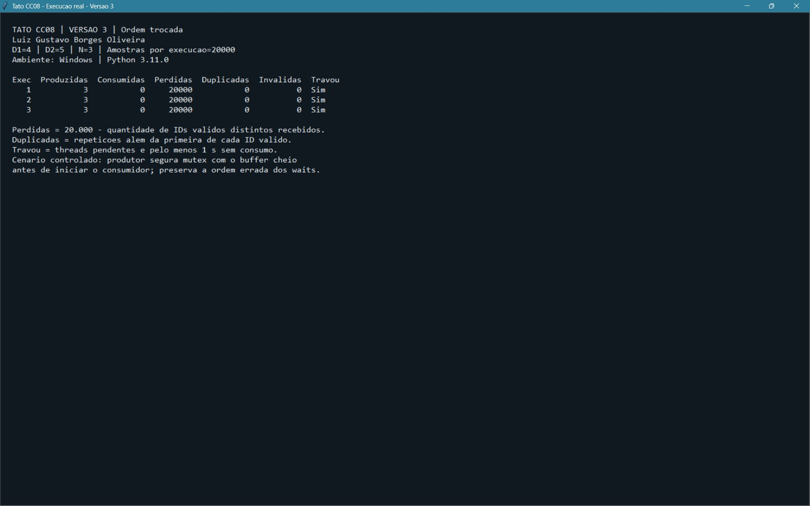
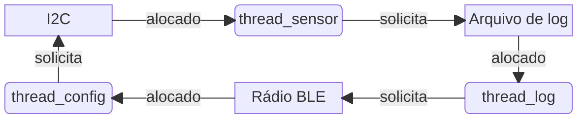

Luiz Gustavo Borges Oliveira | D1 = 4 | D2 = 5 | N = 3

# Ponderada CC08 — Do pipeline ao deadlock

A contagem de Luiz Gustavo Borges Oliveira resulta em 4 + 7 + 6 + 8 = 25 letras. O primeiro nome tem quatro letras, então D1 = 4. O último dígito do total é 5, portanto D2 = 5. Com isso, o buffer fica com N = 3 + (5 mod 5) = 3 posições, e os parâmetros de processamento ficam:

$$
IC = 100.000 + 20.000 \times 5 = 200.000\text{ instruções/amostra}
$$

$$
m = 3\% + 0,5\% \times 4 = 5\% = 0,05
$$

A pulseira recebe uma amostra a cada 1/100 s = 10 ms, mas precisa processá-la em até 5 ms. Essa diferença é importante nas contas: mesmo que uma amostra termine antes da próxima chegar, o prazo de resposta pode ter sido ultrapassado.

## Parte A

### A1. Escolha do processador

Na plataforma H, basta multiplicar o número de instruções pelo CPI e dividir pelo clock:

$$
T_H = \frac{IC \times CPI}{f}
= \frac{200.000 \times 1,5}{48.000.000}
= 0,00625\text{ s} = 6,25\text{ ms}
$$

O resultado de 6,25 ms passa do limite em 1,25 ms. Assim, a H sem DSP não atende ao requisito. A próxima amostra ainda não teria chegado, mas o prazo para responder à anterior já teria acabado.

Na plataforma V, é preciso incluir o efeito das faltas na cache. Os 120 ciclos foram considerados como penalidade adicional, seguindo a fórmula de CPI do enunciado. O tempo médio de acesso à memória fica:

$$
AMAT = t_{acerto} + m \times penalidade
= 1 + 0,05 \times 120 = 7\text{ ciclos/acesso}
$$

Como o clock é de 1,2 GHz, cada ciclo dura aproximadamente 0,8333 ns. Assim, AMAT = 7 × 0,8333 ≈ 5,8333 ns. O CPI efetivo fica:

$$
CPI_{efetivo} = 1,0 + 1,3 \times 0,05 \times 120
= 1 + 7,8 = 8,8
$$

$$
T_V = \frac{200.000 \times 8,8}{1.200.000.000}
= 0,0014667\text{ s} \approx 1,4667\text{ ms}
$$

Somando o atraso máximo do Linux informado:

$$
T_{V,com\ atraso} = 1,4667 + 3 = 4,4667\text{ ms}
$$

Com o atraso do Linux, o tempo chega a 4,4667 ms. A V atende ao cenário pedido, mas sobram apenas 0,5333 ms. Esse cálculo soma o atraso máximo informado pelo enunciado a um tempo baseado na taxa média de faltas de cache; por isso, ainda não prova o tempo máximo de qualquer execução real.

O DSP muda o resultado da H, mas acelera apenas o filtro, que ocupa 60% do tempo. Aplicando a Lei de Amdahl:

$$
S = \frac{1}{(1-0,60) + \frac{0,60}{5}}
= \frac{1}{0,40 + 0,12}
= \frac{1}{0,52} \approx 1,9231
$$

$$
T_{H,DSP} = \frac{6,25}{1,9231}
= 6,25 \times 0,52 = 3,25\text{ ms}
$$

Separando o tempo em duas partes, os 40% sem aceleração continuam levando 6,25 × 0,40 = 2,50 ms. Já o filtro passa de 3,75 ms para 3,75/5 = 0,75 ms. A soma é 3,25 ms, deixando 1,75 ms de margem. A H com DSP passa a atender ao requisito. A aceleração total fica em aproximadamente 1,92 vez porque parte do trabalho continua sendo executada na mesma velocidade.

| Plataforma | Tempo por amostra | Margem para 5 ms | Atende no modelo? |
|---|---:|---:|:---:|
| H sem DSP | 6,25 ms | −1,25 ms | Não |
| V, com o atraso do Linux | 4,4667 ms | 0,5333 ms | Sim |
| H com DSP | 3,25 ms | 1,75 ms | Sim |

A necessidade de cache na V está ligada ao gargalo de Von Neumann: instruções e dados disputam o acesso à memória principal, e a DRAM externa é lenta em relação à CPU. A cache evita parte dessas buscas. Na H, os caminhos de instruções e dados são separados, e o acesso à SRAM interna leva um ciclo. Isso permite dispensar cache no modelo dado, embora uma arquitetura Harvard também possa utilizá-la.

No computador utilizado, o CPU-Z identifica um Intel Core i5-13500H e mostra as caches na própria aba CPU:



As indicações “L1 Data” e “L1 Inst.” mostram que a L1 é separada para dados e instruções. Nessa parte do processador, a organização é Harvard modificada. Já a memória principal e o espaço de endereçamento dos programas seguem o modelo Von Neumann. A divisão da L1, portanto, não transforma o computador inteiro em Harvard puro.

### A2. Pipeline do filtro

Para acompanhar as dependências e os ciclos, as instruções foram identificadas de I1 a I7:

```asm
I1: lw   x5, 0(x10)
I2: add  x6, x6, x5
I3: lw   x7, 0(x11)
I4: sub  x6, x6, x7
I5: sw   x6, 0(x12)
I6: addi x10, x10, 4
I7: addi x11, x11, 4
```

As dependências RAW aparecem quando uma instrução precisa ler o resultado de uma anterior. No trecho do filtro, são estas:

| Produtora | Consumidora | Registrador | Motivo |
|---|---|---|---|
| I1 | I2 | x5 | A soma utiliza a amostra nova carregada da memória. |
| I2 | I4 | x6 | A subtração utiliza a soma já atualizada. |
| I3 | I4 | x7 | A subtração utiliza a amostra antiga carregada. |
| I4 | I5 | x6 | O armazenamento grava o resultado da subtração. |

I5 precisa do x6 produzido por I4, que substitui o valor anterior de I2. Os incrementos de x10 e x11 ocorrem depois de suas leituras no trecho original; essas relações são de leitura antes de escrita, não RAW. Entre iterações do loop, os novos ponteiros e o acumulador também serão usados na iteração seguinte.

Sem forwarding, a instrução que usa o dado precisa esperar sua escrita no banco de registradores. Como WB escreve na primeira metade do ciclo e ID lê na segunda, a leitura pode ocorrer no próprio ciclo de WB. Para montar o diagrama, foi considerada a ausência de conflito estrutural entre a busca de instruções e o acesso aos dados.

Nos diagramas, `ID*` representa a instrução parada em ID, e `IF*` representa a instrução retida na entrada do pipeline. Repetições desses estágios não são novas instruções. O símbolo `—` indica ausência da instrução naquele ciclo. O `sw` termina sua operação em MEM e não escreve registrador em WB.

| Instrução | 1 | 2 | 3 | 4 | 5 | 6 | 7 | 8 | 9 | 10 | 11 | 12 | 13 | 14 | 15 | 16 | 17 |
|---|---|---|---|---|---|---|---|---|---|---|---|---|---|---|---|---|---|
| I1 | IF | ID | EX | MEM | WB | — | — | — | — | — | — | — | — | — | — | — | — |
| I2 | — | IF | ID* | ID* | ID | EX | MEM | WB | — | — | — | — | — | — | — | — | — |
| I3 | — | — | IF | IF* | IF* | ID | EX | MEM | WB | — | — | — | — | — | — | — | — |
| I4 | — | — | — | — | — | IF | ID* | ID* | ID | EX | MEM | WB | — | — | — | — | — |
| I5 | — | — | — | — | — | — | IF | IF* | IF* | ID* | ID* | ID | EX | MEM | — | — | — |
| I6 | — | — | — | — | — | — | — | — | — | IF | IF* | IF* | ID | EX | MEM | WB | — |
| I7 | — | — | — | — | — | — | — | — | — | — | — | — | IF | ID | EX | MEM | WB |

São duas bolhas por I1 → I2, duas por I3 → I4 e duas por I4 → I5. A dependência I2 → I4 já fica resolvida durante a espera por I3. O total é:

$$
C_{sem\ forwarding} = 7 + (5-1) + 2 + 2 + 2 = 17\text{ ciclos}
$$

Com forwarding, o resultado pode seguir diretamente para quem vai utilizá-lo, incluindo o dado gravado pelo `sw`. Isso elimina a espera pelas operações aritméticas. Ainda sobra uma bolha em cada uma das duas dependências load-use:

| Instrução | 1 | 2 | 3 | 4 | 5 | 6 | 7 | 8 | 9 | 10 | 11 | 12 | 13 |
|---|---|---|---|---|---|---|---|---|---|---|---|---|---|
| I1 | IF | ID | EX | MEM | WB | — | — | — | — | — | — | — | — |
| I2 | — | IF | ID* | ID | EX | MEM | WB | — | — | — | — | — | — |
| I3 | — | — | IF | IF* | ID | EX | MEM | WB | — | — | — | — | — |
| I4 | — | — | — | — | IF | ID* | ID | EX | MEM | WB | — | — | — |
| I5 | — | — | — | — | — | IF | IF* | ID | EX | MEM | — | — | — |
| I6 | — | — | — | — | — | — | — | IF | ID | EX | MEM | WB | — |
| I7 | — | — | — | — | — | — | — | — | IF | ID | EX | MEM | WB |

$$
C_{com\ forwarding} = 7 + 4 + 1 + 1 = 13\text{ ciclos}
$$

As bolhas permanecem em I1 → I2, por x5, e I3 → I4, por x7. O `lw` só disponibiliza o dado ao final de MEM. A instrução seguinte precisaria dele em EX nesse mesmo ciclo, antes de o carregamento estar concluído. O forwarding não consegue antecipar um dado que ainda não ficou pronto.

As duas bolhas podem ser preenchidas com instruções independentes. Para isso, o segundo carregamento e o incremento de x10 passam a executar mais cedo:

```asm
I1: lw   x5, 0(x10)
I3: lw   x7, 0(x11)
I6: addi x10, x10, 4
I2: add  x6, x6, x5
I4: sub  x6, x6, x7
I5: sw   x6, 0(x12)
I7: addi x11, x11, 4
```

| Instrução | 1 | 2 | 3 | 4 | 5 | 6 | 7 | 8 | 9 | 10 | 11 |
|---|---|---|---|---|---|---|---|---|---|---|---|
| I1 | IF | ID | EX | MEM | WB | — | — | — | — | — | — |
| I3 | — | IF | ID | EX | MEM | WB | — | — | — | — | — |
| I6 | — | — | IF | ID | EX | MEM | WB | — | — | — | — |
| I2 | — | — | — | IF | ID | EX | MEM | WB | — | — | — |
| I4 | — | — | — | — | IF | ID | EX | MEM | WB | — | — |
| I5 | — | — | — | — | — | IF | ID | EX | MEM | — | — |
| I7 | — | — | — | — | — | — | IF | ID | EX | MEM | WB |

$$
C_{reordenado} = 7 + 4 = 11\text{ ciclos}
$$

O incremento de x10 continua depois de sua leitura em I1 e não altera os operandos das outras instruções. As duas leituras de memória continuam antes da gravação, e a soma continua antes da subtração. Com as operações independentes entre os carregamentos e seus usos, os dados ficam disponíveis a tempo do forwarding.

### A3. Organização do software

A leitura do sensor, o processamento e o acionamento do motor ficam em três threads de um mesmo processo. Como essas tarefas usam as mesmas amostras, compartilhar o buffer evita cópias entre processos. A criação e a troca de contexto de threads também costumam custar menos, já que o espaço de endereçamento é compartilhado. Cada thread mantém seus próprios registradores, contador de programa e pilha. Nesse caso, elas seriam criadas uma vez, na inicialização.

O BLE fica em outro processo, com permissões limitadas, porque recebe dados externos e pode sofrer atrasos na comunicação. Os logs são enviados por uma fila limitada, e os comandos chegam por IPC e passam por validação antes de alterar o funcionamento da pulseira. Se a fila encher, o log pode ser descartado e essa perda registrada, sem segurar a vibração. A comunicação entre processos traz custo de escalonamento e possíveis cópias, mas não precisa ficar no caminho obrigatório entre sensor, filtro e motor.

A separação ajuda a isolar falhas, mas o prazo ainda depende das prioridades, dos tempos de espera e da interferência entre as tarefas. O atraso do Linux calculado na A1 continua existindo.

Essa escolha faz diferença se uma falha no BLE for explorada. Como thread do processo principal, o módulo teria acesso à memória do controle e poderia alterar amostras, corromper o buffer ou derrubar o processo inteiro. Em um processo separado, não há esse acesso direto, e o BLE pode ser reiniciado sem reiniciar o controle. Ainda é necessário validar o IPC, pois aceitar comandos perigosos permitiria que a falha atravessasse a interface. Uma vulnerabilidade no kernel também pode comprometer esse isolamento.

Os estados e as transições de um processo podem ser representados assim:



A thread do sensor tende a passar a maior parte do tempo bloqueada, esperando a próxima leitura ou a conclusão da E/S. Como a amostragem acontece a cada 10 ms, consultar o sensor continuamente só gastaria CPU. Quando o evento ocorre, a thread volta ao estado pronto e aguarda ser escalonada. Esse modelo de estados também se aplica às threads escalonáveis do processo.

### A4. Teste do buffer

As três versões foram feitas em Python com `threading` e um buffer circular de três posições. Cada versão foi executada três vezes, no Windows com Python 3.11.0, tentando entregar as 20.000 amostras numeradas de 0 a 19.999. O objetivo desse teste é observar a concorrência entre as threads; o tempo total do programa não corresponde ao tempo de processamento do firmware.

Na primeira versão, as threads ficam consultando o contador para saber se podem continuar. O `sleep(0)` nesse laço cede a fatia de execução, mas a espera continua sendo por polling. Há também um `sleep(0)` entre ler e escrever o contador, como pedido no enunciado, para permitir a interrupção no meio da atualização.

O teste registra travamento quando ainda existem threads pendentes e o consumidor passa pelo menos um segundo sem receber nada. Cada repetição roda em um processo filho, que pode ser encerrado depois do registro dos resultados. Isso permite terminar uma execução bloqueada sem liberar os semáforos à força ou esconder o deadlock.

Na tabela, “consumidas” conta as leituras realizadas. As perdas são calculadas por 20.000 menos o número de IDs válidos distintos recebidos, enquanto as duplicações contam as repetições além da primeira ocorrência de cada ID. Leituras inválidas ficam em outra coluna. Quando há travamento, as perdas também incluem o que nem chegou a ser produzido, pois a comparação é com as 20.000 amostras planejadas.

| Versão | Execução | Produzidas | Consumidas | Perdidas | Duplicadas | Inválidas | Travou? |
|---:|---:|---:|---:|---:|---:|---:|:---:|
| 1 | 1 | 20.000 | 19.828 | 471 | 299 | 0 | Sim |
| 1 | 2 | 20.000 | 19.858 | 537 | 395 | 0 | Sim |
| 1 | 3 | 20.000 | 19.872 | 360 | 232 | 0 | Sim |
| 2 | 1 | 20.000 | 20.000 | 0 | 0 | 0 | Não |
| 2 | 2 | 20.000 | 20.000 | 0 | 0 | 0 | Não |
| 2 | 3 | 20.000 | 20.000 | 0 | 0 | 0 | Não |
| 3 | 1 | 3 | 0 | 20.000 | 0 | 0 | Sim |
| 3 | 2 | 3 | 0 | 20.000 | 0 | 0 | Sim |
| 3 | 3 | 3 | 0 | 20.000 | 0 | 0 | Sim |

Os registros completos estão nos arquivos `a4_versao1.txt/json`, `a4_versao2.txt/json` e `a4_versao3.txt/json`, em `img/`. Os prints mostram esses registros nas janelas de visualização, com as três execuções de cada versão. Os números da primeira versão podem mudar ao repetir o teste, porque dependem do escalonamento.







Na versão sem sincronização, a região crítica envolve o estado do buffer, seus índices e o contador. Como há um único produtor e um único consumidor, cada índice é atualizado por uma só thread. O contador `ocupadas`, porém, é alterado pelas duas. O problema está na leitura e na escrita separadas:

```python
anterior = ocupadas
time.sleep(0)
ocupadas = anterior + 1  # No consumidor, anterior - 1.
```

Por exemplo, com `ocupadas = 1`, o produtor lê 1 para escrever 2. Antes da escrita, o consumidor também lê 1 para escrever 0. Se a escrita do consumidor ocorrer por último, o contador termina em 0, embora uma inserção e uma retirada devessem manter o valor 1. Se a escrita do produtor ocorrer por último, termina em 2. Essa atualização perdida faz o contador deixar de representar o buffer, permitindo sobrescritas ou leituras de valores antigos. Por isso, surgem perdas, duplicações e espera sem progresso. O GIL do CPython não torna toda essa sequência uma operação atômica, principalmente com a cessão explícita de execução.

Na segunda versão, cada semáforo controla uma parte desse acesso:

| Semáforo | Valor inicial | Garantia |
|---|---:|---|
| vazio | 3 | Reserva uma posição antes de escrever e bloqueia o produtor se não houver vaga. |
| cheio | 0 | Reserva uma amostra antes de ler e bloqueia o consumidor se não houver item. |
| mutex | 1 | Permite apenas uma thread por vez na alteração do buffer, dos índices e do contador. |

O produtor faz `wait(vazio) → wait(mutex)`, escreve, libera `mutex` e sinaliza `cheio`. O consumidor faz `wait(cheio) → wait(mutex)`, lê, libera `mutex` e sinaliza `vazio`. A espera por vaga ou item ocorre antes de reter o mutex. Nas três execuções, as 20.000 amostras foram entregues sem perdas, duplicações ou travamentos.

Na terceira versão, o produtor passa a fazer `wait(mutex) → wait(vazio)`. Para observar uma sequência que leva ao deadlock, o consumidor só começa quando o produtor já encheu o buffer e adquiriu novamente o mutex. Um evento do teste controla esse instante de início, sem modificar os valores dos semáforos.

Nesse instante, o produtor espera uma vaga segurando o mutex. O consumidor consegue reservar um item em `cheio`, mas fica esperando o mutex para retirá-lo. Sem retirada, não há liberação de `vazio`; sem uma vaga, o produtor não chega à liberação do mutex. As duas threads ficam em deadlock. Por isso, foram produzidas apenas três amostras e nenhuma foi consumida nas três repetições. O resultado demonstra uma sequência possível que trava; não significa que qualquer escalonamento da versão 3 teria exatamente a mesma quantidade de consumo.

### A5. Deadlock da pulseira

O deadlock pode começar com a thread do sensor adquirindo I2C e fazendo a leitura. Antes de ela conseguir o log, a thread de log adquire esse recurso. A thread de configuração, por sua vez, adquire BLE e recebe o comando. Nesse momento, cada thread está segurando seu primeiro recurso.

Depois disso, a thread do sensor pede o log e bloqueia, pois ele está com a thread de log. A thread de log pede BLE e bloqueia, pois ele está com a configuração. Por fim, a configuração pede I2C e bloqueia, pois ele está com o sensor. Nenhuma consegue chegar às operações de liberação.

No grafo, recurso → thread significa alocação, e thread → recurso significa solicitação pendente. Cada recurso possui uma única instância.



Nessa sequência, aparecem as quatro condições necessárias para o deadlock:

| Condição | Como aparece no código |
|---|---|
| Exclusão mútua | Cada semáforo permite que apenas uma thread utilize seu recurso de cada vez. |
| Posse e espera | Cada thread mantém o primeiro recurso enquanto espera pelo segundo. |
| Ausência de preempção | O recurso não é retirado à força; a liberação depende do `V` executado por quem o adquiriu. |
| Espera circular | O sensor espera pelo log, o log pelo BLE e a configuração pelo I2C mantido pelo sensor. |

Para prevenir esse ciclo, pode ser definida uma ordem única de aquisição: `I2C < log < BLE`. Sensor e log já seguem essa ordem. A configuração precisa receber e copiar o comando, liberar BLE e só depois adquirir I2C para ajustar o sensor. Se uma rotina realmente precisar manter dois recursos ao mesmo tempo, deve adquiri-los na ordem definida. A regra precisa valer para todas as rotinas.

Essa mudança rompe a espera circular. Para a pessoa que utiliza a pulseira, evita o congelamento por esse ciclo, enquanto comandos de configuração podem aguardar processamento. Ainda é necessário limitar o tempo das regiões críticas e evitar E/S demorada segurando recursos usados pelo sensor, pois prevenir deadlock não demonstra o cumprimento dos 5 ms.

Outra possibilidade é trabalhar com detecção e recuperação. O sistema registra quem possui cada recurso e quem está esperando, permitindo que um supervisor procure ciclos de espera. Ao confirmar um ciclo, ele registra a falha e reinicia o processo de controle, recompondo os recursos e o estado do hardware. Um watchdog independente pode atuar se o supervisor também parar. Um tempo de espera alto, sozinho, só indica uma suspeita; para confirmar o ciclo, é necessário observar quem segura e quem solicita cada recurso.

Para quem utiliza a pulseira, essa recuperação reduz a duração de um congelamento, mas pode interromper a vibração e exige uma sinalização de falha reconhecível. Não se deve simplesmente liberar o semáforo de outra thread e continuar, pois o recurso pode estar com o estado incompleto. A recuperação não mantém o requisito de 5 ms durante a falha; por isso, para este produto, funciona como proteção adicional à prevenção.

## Parte B

Ao conselho da Tato | Dilema 2: processador para produção

Será adotada a plataforma H com DSP para produzir a pulseira. A H sozinha leva 6,25 ms e não cumpre o prazo. Com o DSP, o tempo cai para 3,25 ms e sobram 1,75 ms até o limite. A V também atende à conta feita na Parte A, mas chega a 4,4667 ms com o atraso do Linux e deixa apenas 0,5333 ms de margem. Para um dispositivo que precisa avisar sobre obstáculos enquanto a pessoa anda, essa diferença pesa na escolha.

O custo também favorece a H com DSP: R$ 22 + R$ 15 = R$ 37 por pulseira, contra R$ 70 da V. São R$ 33 de diferença por unidade. Em um lote de 2.000 pulseiras, usado como exemplo, o gasto passa de R$ 140.000 para R$ 74.000, uma diferença de R$ 66.000 nesses componentes. Parte desse valor pode ser destinada aos testes e à assistência.

O custo dessa decisão aparece na manutenção. A H precisa ser atualizada por cabo na assistência, então a empresa terá de manter esse atendimento, e o usuário terá de se deslocar ou ficar um período sem a pulseira. Isso também dificulta corrigir rapidamente uma vulnerabilidade. Será necessário autenticar o firmware, controlar as versões e priorizar o atendimento de falhas críticas. Mesmo sem Linux, o BLE e o próprio firmware continuam sujeitos a falhas.

A maior margem de processamento precisa ser confirmada no hardware real, com o BLE ativo e nas situações de maior carga. A decisão será revista se qualquer amostra passar de 5 ms ou se a manutenção adicional da H custar, em média, mais de R$ 33 por unidade. Uma migração para a V dependerá de comprovar o prazo nessas condições e de oferecer atualização autenticada. A conta com faltas médias de cache ainda não basta para garantir esse comportamento.

## Referências

- Enunciado: [Ponderada Computação CC08 — Do pipeline ao deadlock](https://docs.google.com/document/d/1oQb665Vap52bXLAJ_C_LaT3Ts0_ewt4jFQ_Rq94VmDs), fornecido para a atividade.
- Python Software Foundation. [threading — Thread-based parallelism](https://docs.python.org/3/library/threading.html), documentação de threads e semáforos.
- CPU-Z, captura do computador utilizado, salva em `img/cpu_z_caches.png`.
